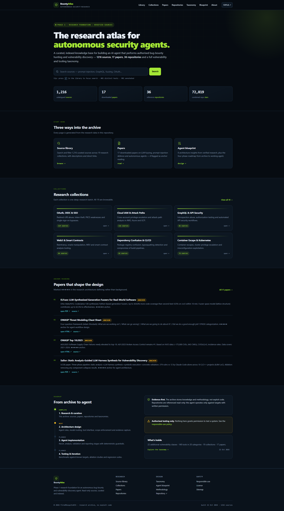
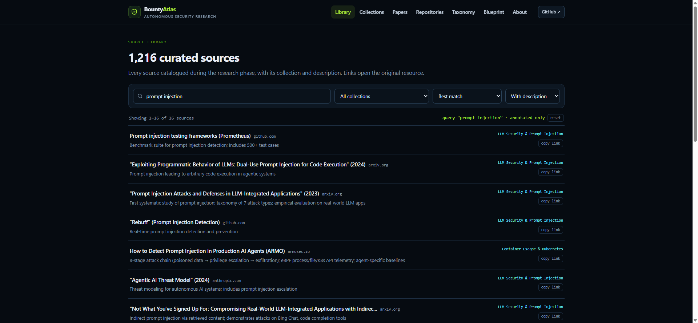
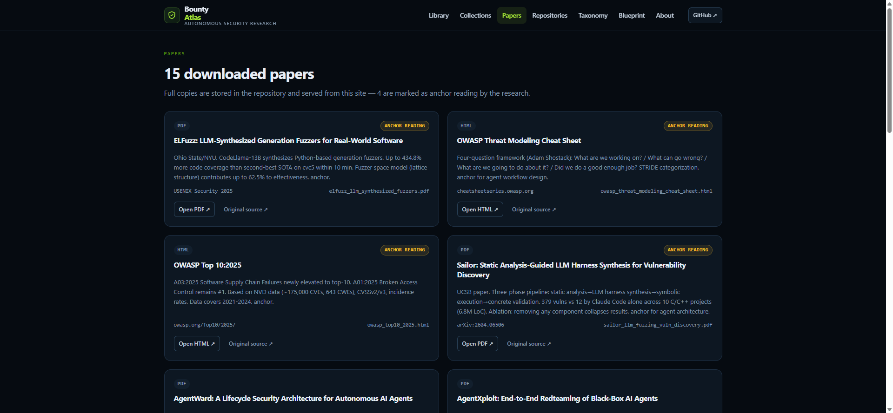
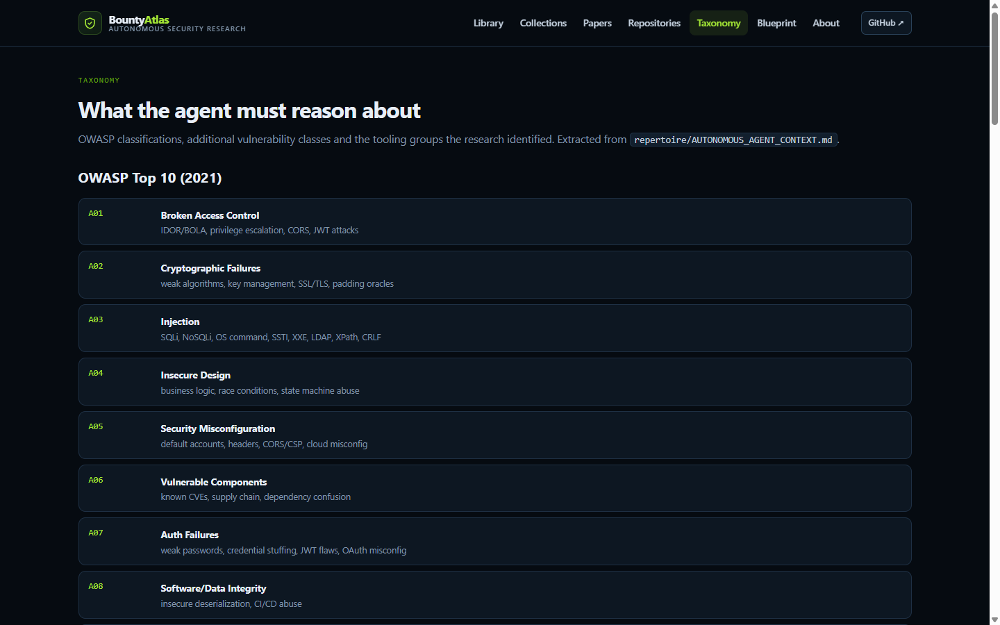
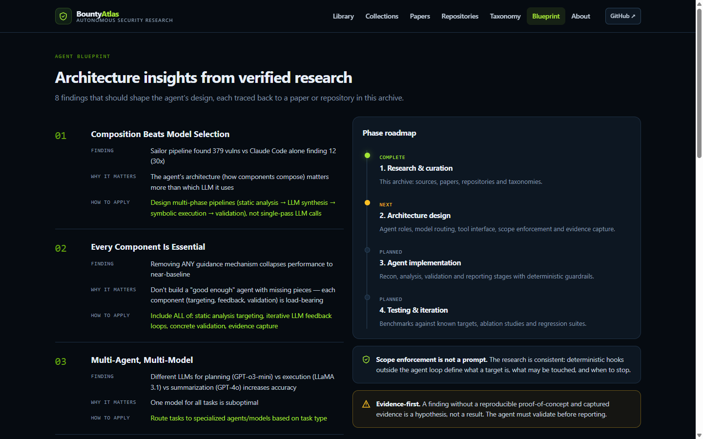

# Bounty Atlas — research for autonomous security agents

**A curated, searchable knowledge base for building an AI agent that performs authorised bug-bounty hunting and vulnerability discovery.**

[](LICENSE)
[](#whats-inside)
[](repertoire/01_papers)
[](#repositories)
[](tests/)
[](https://bugbounty.danubelabs.net/)

[**Browse the atlas →**](https://bugbounty.danubelabs.net/)



---

## What this is

This repository is **Phase 1 (research & curation)** of an autonomous bug-bounty agent. It collects
the methodology, papers, tooling and real-world patterns an agent needs to reason about security
testing — and publishes them as a searchable static site instead of a folder of markdown.

The catalogue is real: every count, collection and description on the site is generated from the
research files in `repertoire/`. There are no mock pages.

> **Scope:** web, APIs, cloud, containers, mobile, wireless, Web3, memory corruption, supply chain,
> LLM security and agent security. Sources are catalogued, not endorsed.

---

## What's inside

| Asset | Count | Where |
| --- | --- | --- |
| Catalogued sources (unique URLs, 401 hosts) | **1,216** | `repertoire/_new_sources_full.tsv` |
| Research collections | **19** | derived from the source reports |
| Papers downloaded (15 unique works, 17 files) | **15** | `repertoire/01_papers/` |
| Reference repositories (72,819 stars) | **36** | `repertoire/REPO_MANIFEST.md` |
| OWASP classes + additional vulnerability classes | **10 + 22** | `repertoire/AUTONOMOUS_AGENT_CONTEXT.md` |
| Tooling groups / tools catalogued | **20 / 160+** | same document |
| Architecture insights | **8** | same document |

### The site

| Search the library | Papers |
| --- | --- |
|  |  |

| Taxonomy | Agent blueprint |
| --- | --- |
|  |  |

Live pages: [library](https://bugbounty.danubelabs.net/library.html) ·
[papers](https://bugbounty.danubelabs.net/papers.html) ·
[repositories](https://bugbounty.danubelabs.net/repos.html) ·
[taxonomy](https://bugbounty.danubelabs.net/taxonomy.html) ·
[blueprint](https://bugbounty.danubelabs.net/blueprint.html)

The library is fully client-side: text search across titles, descriptions and hosts, collection
filter, annotation filter, four sort orders, pagination and shareable URL state
(`?q=…&c=…&d=…&page=…`).

---

## Quick start

```bash
git clone https://github.com/FiredMosquito831/bugbounty-cybersec-ai-agent-resources.git
cd bugbounty-cybersec-ai-agent-resources

python -m venv .venv
.venv\Scripts\activate          # Windows
# source .venv/bin/activate     # macOS / Linux
pip install -r requirements.txt

# regenerate the dataset and the site
python scripts/build_data.py
python scripts/build_site.py

# preview
python -m http.server 8100 --directory docs
# → http://127.0.0.1:8100
```

`build_data.py` parses the raw research files into `data/*.json`.
`build_site.py` renders `docs/` from those JSON files, copies the papers and emits the sitemap,
robots file and library dataset.

Tests:

```bash
pytest
```

They validate the dataset invariants (unique URLs, collection totals, paper/file mapping without
duplicates, repository links, taxonomy completeness) and the parser helpers.

---

## Repository layout

```
repertoire/                 raw research archive
  00_REPERTOIRE_INDEX.md    master index of every source
  AUTONOMOUS_AGENT_CONTEXT.md  architecture context, taxonomies, insights
  REPO_MANIFEST.md          36 repositories with URLs and stars
  _new_sources_full.tsv     1,216 sources (collection | header | title | URL | description)
  01_papers/                15 papers as PDF/HTML
data/                       generated JSON (sources, collections, papers, repos, taxonomy, blueprint)
scripts/
  build_data.py             TSV/index/manifest/context → JSON
  build_site.py             JSON → docs/ (HTML, assets, papers, sitemap)
site/
  templates/                Jinja2 templates
  static/                   CSS, JS, favicon, screenshots
docs/                       generated site (GitHub Pages source)
tests/                      dataset integrity tests
```

### Why two build steps

The research archive is a set of human-maintained documents. The site is derived, never edited by
hand. That keeps the catalogue authoritative and means a new source only has to be added once:

1. Add a row to `repertoire/_new_sources_full.tsv`
   (`collection id`, `collection header`, `title`, `URL`, `description`).
2. Run `python scripts/build_data.py && python scripts/build_site.py`.
3. Commit the new JSON and `docs/` alongside the source change.

CI runs both builds and fails if the committed output is stale.

---

## The agent blueprint

The archive exists to feed Phase 2. The site's [blueprint](https://bugbounty.danubelabs.net/blueprint.html)
summarises eight insights from verified research, including:

- **Composition beats model selection** — a Sailor-style pipeline found 379 vulnerabilities vs 12 for a single-pass agent.
- **Every component is load-bearing** — ablation studies collapse when validation or feedback is removed.
- **Scope enforcement belongs outside the agent loop** — deterministic hooks, not prompt instructions.
- **Evidence-first** — a finding without a reproducible proof-of-concept is a hypothesis.

Roadmap: Phase 1 research (complete) → Phase 2 architecture → Phase 3 implementation → Phase 4 testing.

---

## Responsible use

This archive is for **authorised security research, education and defensive engineering**.
Nothing here grants permission to test a system. Always obtain written authorisation, respect the
scope and rules of engagement, and stop when a test could affect availability or third-party data.

The repository contains no exploit code or active attack tooling — only links, metadata, papers and
methodology. Referenced repositories are read-only references; audit them before use. See
[SECURITY.md](SECURITY.md) for the full policy.

## License

MIT for the site generator, templates and original text — see [LICENSE](LICENSE).
Linked third-party resources, papers and repositories remain the property of their authors.
